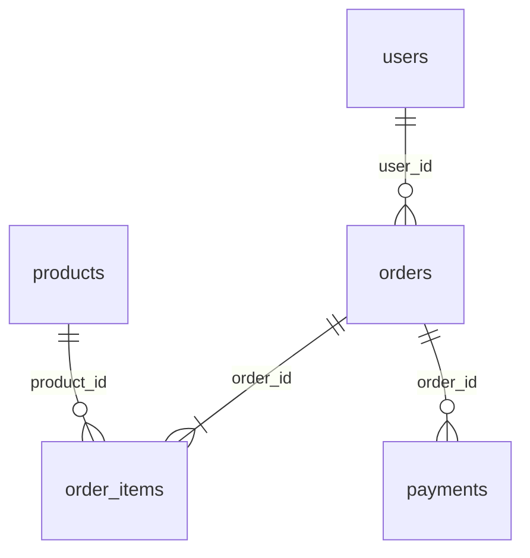

# SQL para QA y Soporte

Repaso de las consultas `SELECT` que más se usan para **validar datos (QA)** y **analizar casos de usuarios (soporte técnico)**, con ejemplos sobre una base ficticia de una tienda online.

Es un material de estudio: cada consulta indica qué pregunta responde, cuántas filas devuelve y en qué hay que fijarse. Se va ampliando con nuevos temas.

## Para qué sirve

- **QA:** comprobar que los datos que dejan la interfaz o la API son correctos (campos vacíos, valores imposibles, totales que no cierran).
- **Soporte:** encontrar el registro de un cliente, ver el estado de un pedido o contar cuántos casos hay de cada tipo.
- **Repaso:** tener a mano la sintaxis y los errores típicos de cada consulta.

## Índice

| Guía | Tema | Estado |
| --- | --- | --- |
| [01 · SELECT básico](guia/01-select-basico.md) | columnas, `DISTINCT`, alias, columnas calculadas | ✅ |
| [02 · Filtros](guia/02-filtros.md) | `WHERE`, `AND`/`OR`, `IN`, `BETWEEN`, `LIKE`, `NULL`, fechas | ✅ |
| [03 · Ordenar y limitar](guia/03-ordenar-y-limitar.md) | `ORDER BY`, `TOP` / `LIMIT` | ✅ |
| [04 · Agregaciones](guia/04-agregaciones.md) | `COUNT`, `SUM`, `AVG`, `MIN`, `MAX` y chequeos rápidos de datos | ✅ |
| [05 · GROUP BY y HAVING](guia/05-group-by-y-having.md) | resúmenes por grupo, `WHERE` contra `HAVING` | ✅ |
| [06 · JOINs](guia/06-joins.md) | `INNER`, `LEFT`, `FULL`, datos sin pareja | ✅ |
| [07 · Subconsultas y CTE](guia/07-subconsultas-y-cte.md) | `IN`, `NOT EXISTS`, `WITH` | ✅ |
| [08 · Validar datos](guia/08-validar-datos.md) | duplicados, huérfanos y consistencia, con reporte de hallazgos | ✅ |
| [Equivalencias PostgreSQL ↔ SQL Server](guia/equivalencias-postgresql-sqlserver.md) | diferencias entre las sintaxtis | ✅ |

## Cómo se lee cada consulta

```
Qué pregunta responde
    consulta
Resultado: cuántas filas devuelve y cuáles
Ojo: el error típico o el detalle que cambia el resultado
```

Cada entrada marca el uso en **QA** y en **Soporte**. Los resultados se comprobaron ejecutando las consultas sobre la base de práctica.

La guía [08 · Validar datos](guia/08-validar-datos.md) usa otro formato: **regla → consulta → esperado (0 filas) → real**, porque en QA una consulta comprueba una regla y las filas que devuelve son la evidencia de un defecto.

## Base de práctica

Una tienda online ficticia con cinco tablas. Los datos tienen **defectos plantados a propósito** (para practicar detección de errores). No hay datos reales.



No se declararon claves foráneas a propósito: con ellas el motor rechazaría las filas inconsistentes y no habría defectos que encontrar. Las relaciones del diagrama son lógicas.

### Cómo cargarla

Crear una base vacía llamada `tienda_qa` y ejecutar el script del motor que uses:

| Motor | Script | Cómo |
| --- | --- | --- |
| SQL Server | [`db/tienda_sqlserver.sql`](db/tienda_sqlserver.sql) | SSMS: seleccionar la base `tienda_qa`, abrir el script y ejecutar (F5) |
| PostgreSQL | [`db/tienda_postgres.sql`](db/tienda_postgres.sql) | pgAdmin: Query Tool sobre `tienda_qa`; o `psql -U postgres -d tienda_qa -f db/tienda_postgres.sql` |

Los scripts borran y recrean las tablas, así que se pueden volver a ejecutar para restaurar los datos.

## Motores

La mayoría de las consultas son SQL estándar y sirven en cualquier motor. Donde la sintaxis cambia (`TOP` contra `LIMIT`, por ejemplo) se muestran las dos versiones.

| Motor | Estado de las consultas |
| --- | --- |
| SQLite | ✅ consultas estándar ejecutadas y filas comprobadas (salvo las variantes propias de cada motor) |
| PostgreSQL | ✅ ejecutadas sobre `db/tienda_postgres.sql` |
| SQL Server | ✅ ejecutadas sobre `db/tienda_sqlserver.sql` |

## Aviso

Material de estudio personal. Si encontrás un error o una consulta mejor, abrí un issue.
